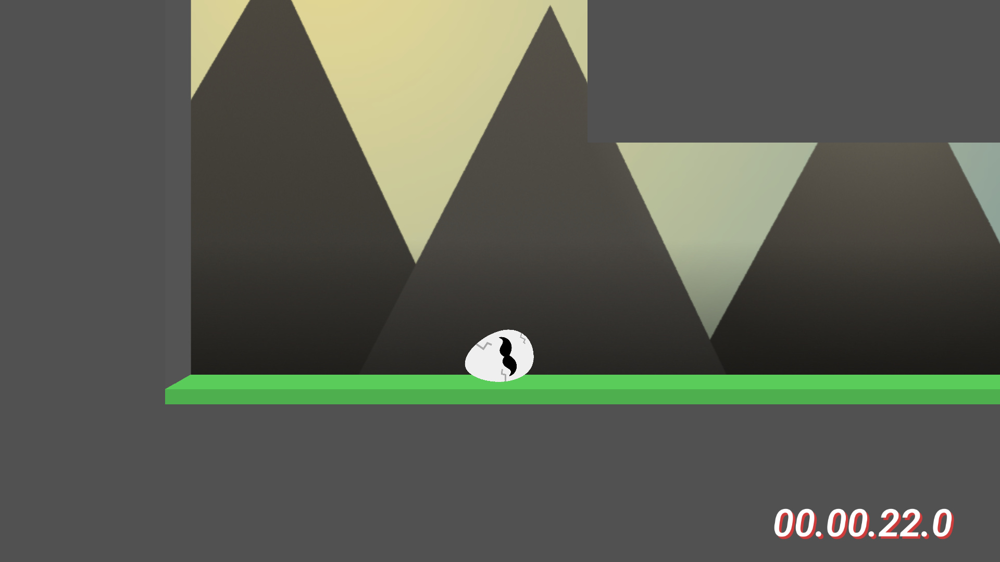
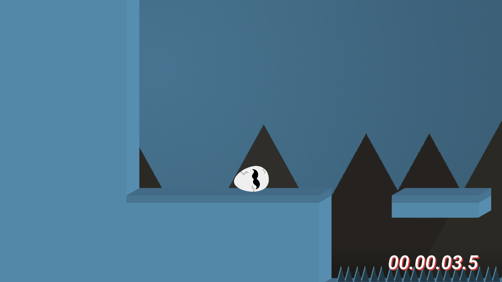
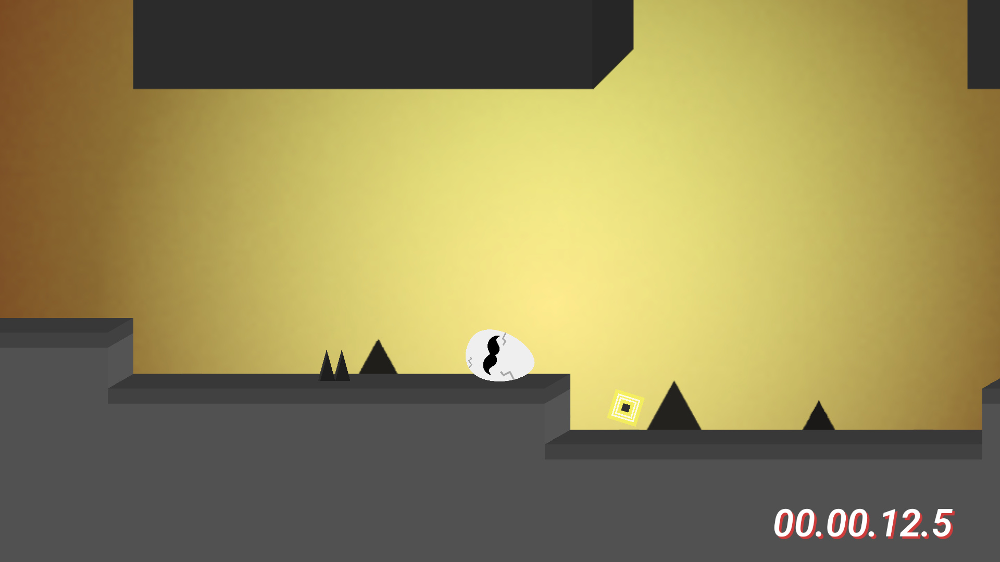
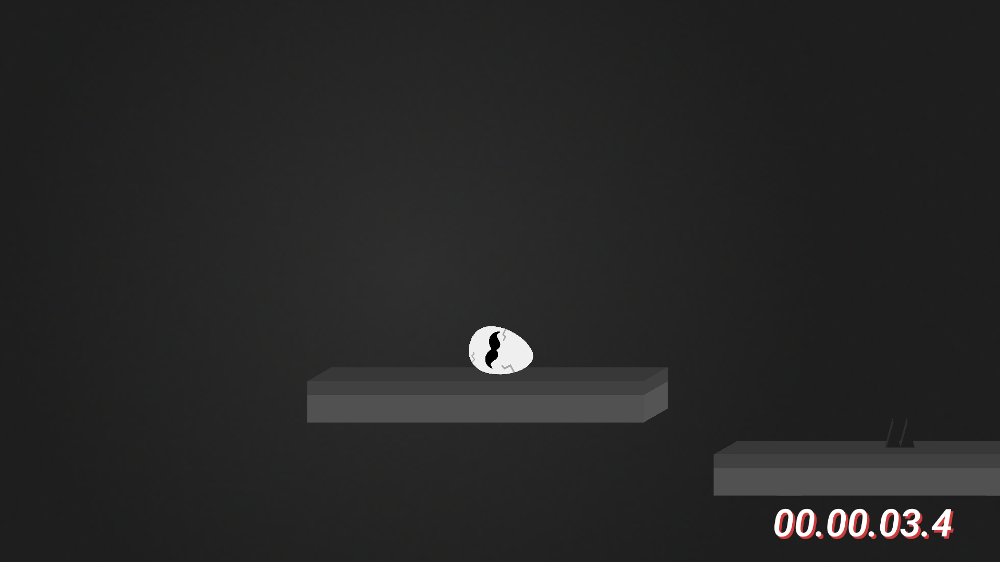

# Egg Returns Home
Egg Returns Home is a simple platformer about an egg, which is trying to find his way back home. At every level egg needs to get to the teleport. Explore the 40 levels of trying to achieve it, if you can...

| :robot: :x: No AI Used                                                                                    |
|:----------------------------------------------------------------------------------------------------------|
| This game has __no code__ assisted/written by the AI. And the same goes for it's __assets__.   It was completely made, written and tested by a __human__. |

 
 
